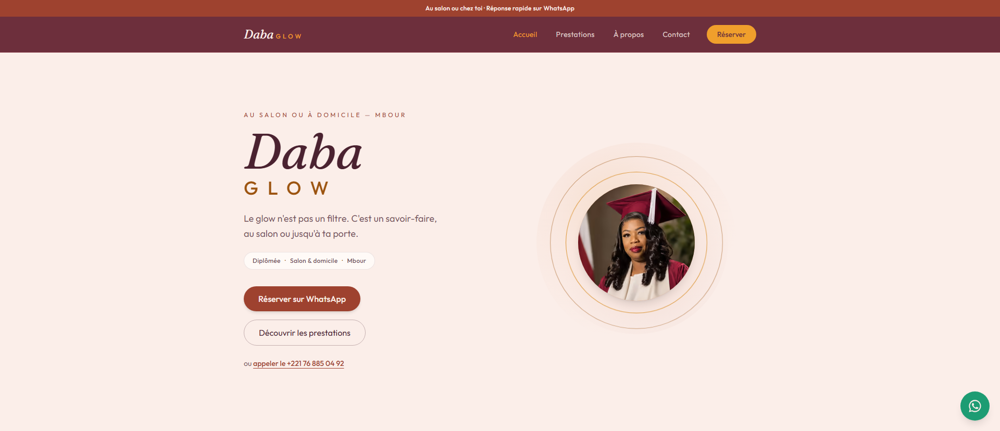
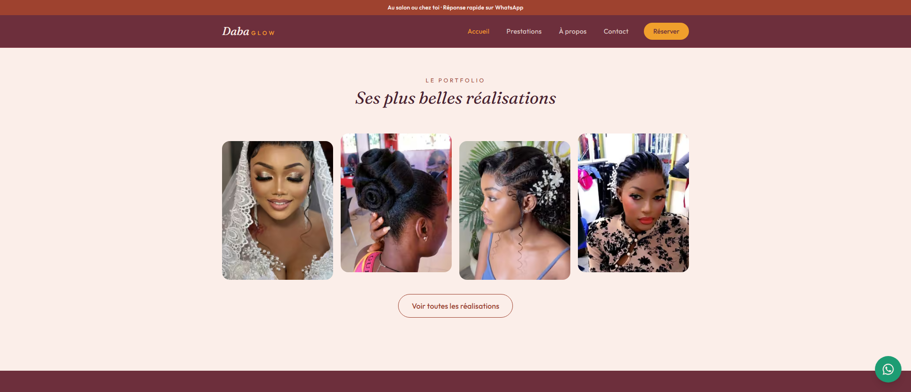
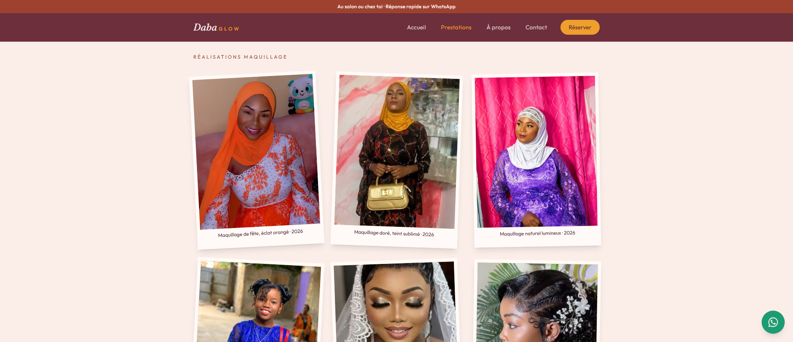
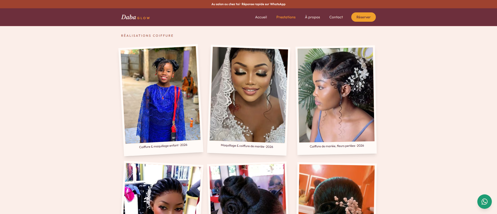
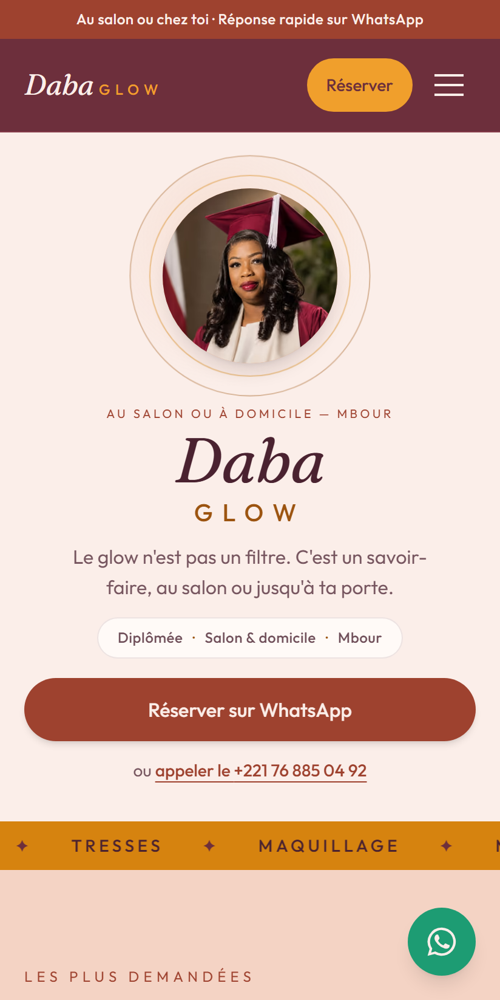
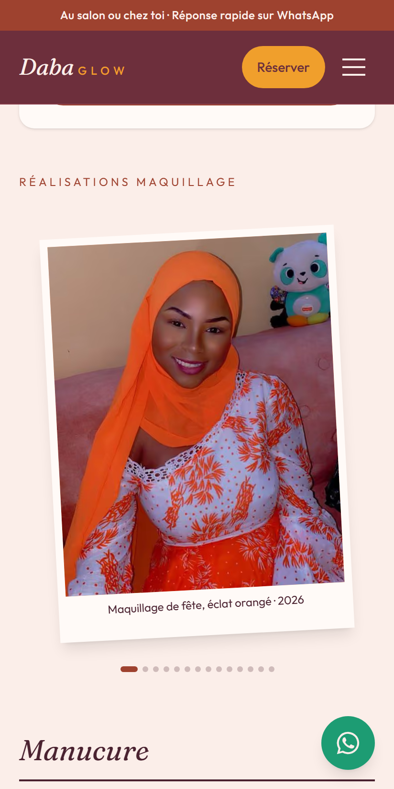
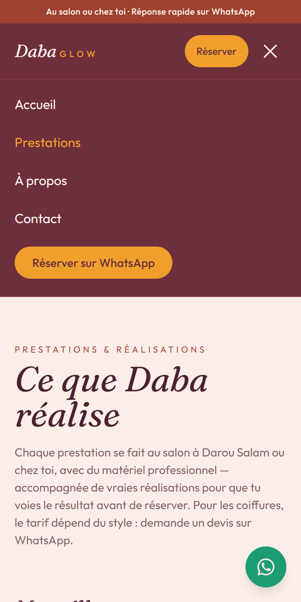

# ✨ Daba Glow — Site vitrine d'un salon de beauté, au salon et à domicile

> Site web conçu pour **Daba Glow**, une activité de maquillage, manucure et
> coiffure à Darou Salam (Mbour, Sénégal), au salon ou à domicile. Objectif :
> présenter les prestations et les réalisations, et permettre de réserver en un
> geste sur WhatsApp, depuis un téléphone Android d'entrée de gamme.
> Direction artistique éditoriale : bordeaux profond, doré, typographie
> Fraunces italique.

Développé avec **Next.js 16, React 19, TypeScript et Tailwind CSS v4**, testé
avec **Vitest et Playwright**, déployé sur **Vercel**.

> **🔗 Démo en ligne : [daba-glow.vercel.app](https://daba-glow.vercel.app/)**

## 🖼️ Aperçu

| Accueil | Réalisations coup de cœur |
| :---: | :---: |
|  |  |

| Prestations et réservation | Portfolio en polaroïds |
| :---: | :---: |
|  |  |

Sur mobile : le portrait et le bouton de réservation dans le premier écran,
une photo entière par écran dans les galeries, un menu simple.

| Premier écran | Galerie | Menu |
| :---: | :---: | :---: |
|  |  |  |

## 📊 Résultats mesurés

Le site a fait l'objet d'un audit complet (code, sécurité, performance,
accessibilité, SEO, design), puis de corrections livrées en 16 pull requests.

| Mesure | Avant (audit, 12/11/2026) | Après (production, 16/11/2026) |
|---|---|---|
| Accessibilité (axe, 4 pages, mobile et desktop) | 113 éléments en violation | **0** |
| PageSpeed Insights mobile, accueil (3 mesures) | — | **Performance 99 à 100, LCP médian 2,1 s** |
| Vulnérabilités des dépendances de production | 3 (1 critique, 2 hautes) | **0** |
| En-têtes de sécurité HTTP | HSTS seul (fourni par Vercel) | **+ CSP**, X-Frame-Options, X-Content-Type-Options, Referrer-Policy, Permissions-Policy |
| Tests | 14 | **175** (Vitest) + **11** (Playwright) |
| Couverture des lignes | 14 % | **92 %** |

## 🧱 Stack technique

| Technologie | Utilisation |
|---|---|
| Next.js 16 (App Router, pages statiques) | Framework et rendu |
| React 19, TypeScript | Composants et typage strict |
| Tailwind CSS v4 | Mise en forme, jetons de couleur, responsive |
| Vitest 5, Testing Library | Tests unitaires et de composants, couverture |
| Playwright, axe-core | Tests de bout en bout et d'accessibilité dans un vrai navigateur |
| GitHub Actions | Intégration continue (Node 22) |
| Vercel | Déploiement et prévisualisation de chaque pull request |
| WhatsApp | Prise de contact et réservation (message pré-rempli) |

## 🧭 Démarche

1. **Audit** : 30 constats classés par gravité, chacun avec sa preuve (fichier et ligne, commande et sortie, capture ou mesure).
2. **Corrections par lots** (16 pull requests), toujours dans le même ordre :
   - branche dédiée ;
   - maquettes avant tout changement visuel ;
   - diff relu et validé, un commit par sujet ;
   - lint, types, tests, build et axe à zéro ;
   - 3 mesures PageSpeed sur la prévisualisation ;
   - vérification de la production après la fusion.
3. **Garde-fous permanents**, vérifiés à chaque lot :
   - 0 violation d'accessibilité, LCP mobile sous 2,5 s ;
   - contenu visible sans JavaScript, animations coupées avec `prefers-reduced-motion` ;
   - aucune adresse exacte ni coordonnée GPS publiée ;
   - un seul numéro pour WhatsApp et les appels.

## 🚀 Démarrer

Node 22 (voir `.nvmrc`).

```bash
npm install
npm run dev        # http://localhost:3000
```

Autres commandes :

```bash
npm test                 # tests unitaires (Vitest)
npm run test:couverture  # tests + couverture (avec seuils)
npm run test:e2e         # Playwright : construit et démarre le site, puis axe, CSP, premier écran mobile
npm run lint             # ESLint
npx tsc --noEmit         # vérification des types
npm run build            # build de production
```

## 🧠 Architecture : séparer le contenu du code

Les pages et les composants lisent leurs textes et leurs données dans le
dossier `content/`. On peut donc changer un prix, une photo ou un texte sans
toucher au code, et réutiliser la même base pour un autre commerce.

| Fichier | Contenu |
|---|---|
| `content/site.config.ts` | Nom, accroche, **numéro (WhatsApp et appels)**, salon (quartier seul), zone, bandeau, horaires |
| `content/prestations.ts` | Prestations, descriptions, prix, durées |
| `content/realisations.ts` | Galerie : photos et vidéos TikTok |
| `content/accueil.ts` | Héros et prestations « les plus demandées » |
| `content/atouts.ts` | Chiffres clés et atouts |
| `content/a-propos.ts`, `content/contact.ts`, `content/temoignages.ts` | Parcours, étapes de réservation, témoignages |

## 🧩 Composants signature

- `Halo` : le portrait dans son halo doré pulsant (héros).
- Reflet doré sur « GLOW » : un éclat qui traverse le mot en boucle, en CSS seul.
- `GalerieCategorie` et `GalerieApercu` : portfolio en polaroïds. Sur mobile, une photo entière par écran avec des points de repère (`DefilementPoints`) ; sur desktop, une grille.
- `Lightbox` : visionneuse au clavier, focus piégé puis rendu au bouton d'origine.
- `PrestationCard` : bouton « Réserver » qui ouvre WhatsApp avec un message pré-rempli pour cette prestation.
- `TikTokEmbed` : vidéo chargée seulement au clic (façade avec vignette).
- `Reveal` : apparition au défilement en CSS (`animation-timeline`), sans JavaScript.

## ✅ Qualité, accessibilité, performance, sécurité

- **Tests** :
  - Vitest : intégrité du contenu (chaque image référencée existe), contrastes calculés depuis les jetons de couleur, rendu sans JavaScript, tutoiement, composants interactifs ;
  - Playwright : axe sur 4 pages à 360 et 1440 px, aucune violation de la CSP, premier écran mobile entier.
- **Intégration continue** à chaque push et pull request :
  - audit des dépendances de production ;
  - lint, types, tests avec seuils de couverture, build ;
  - job Playwright.
- **Accessibilité (WCAG 2.1 AA)** :
  - contrastes vérifiés par les tests, contour de focus visible sur tous les fonds ;
  - zones tactiles d'au moins 44 px, lien d'évitement ;
  - `aria-current`, menu fermé par Échap, `prefers-reduced-motion` respecté.
- **Performance** :
  - contenu du premier écran visible sans JavaScript ;
  - portrait en AVIF/WebP statiques, images dimensionnées (`sizes`) ;
  - galeries rendues une seule fois, CSS intégrée au HTML ;
  - JavaScript client réduit aux seuls composants interactifs.
- **Sécurité** : politique de sécurité du contenu (CSP) stricte, `frame-ancestors 'none'`, en-têtes de sécurité, aucune dépendance vulnérable en production.
- **SEO local** : données structurées `BeautySalon` (sans adresse exacte), URL canoniques, sitemap, Open Graph, manifeste avec icône 512 px « maskable ».

## 🔁 Réutiliser comme template

Pour un nouveau commerce :
1. dupliquer le projet et remplacer le dossier `content/` ;
2. ajuster les couleurs dans `app/globals.css` (`@theme`) et les polices dans `app/layout.tsx` ;
3. lancer `npm test` : les tests de contenu signalent une image manquante ou un champ oublié.

---

Conçu et développé par **Ndeye Penda Sarr 2026**.
